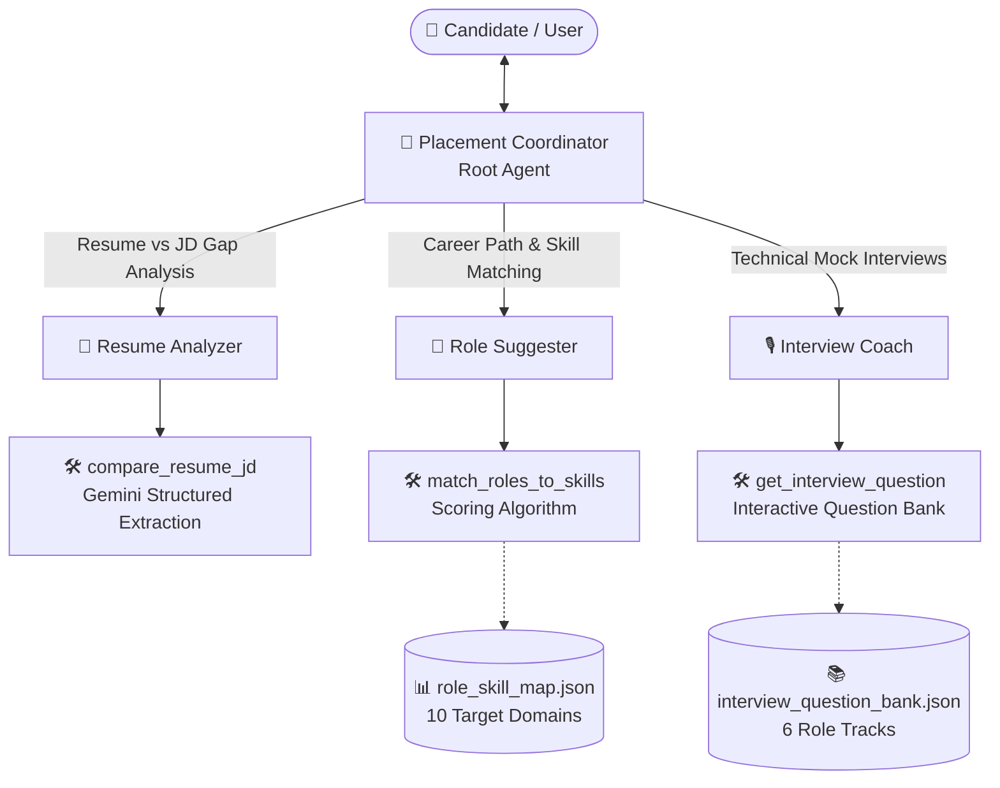

<div align="center">

# 🎓 Placement Multi-Agent System

**An Intelligent Multi-Agent Career Preparation and Placement Ecosystem built on Google's Agent Development Kit (ADK) and Gemini**


</div>

---

## 📌 Project Overview

The **Placement Multi-Agent System** is an end-to-end AI career companion designed to streamline placement and job preparation for students and candidates. Powered by Google's Agent Development Kit (ADK) and Google Gemini, the system employs a hierarchical multi-agent architecture where a central coordinator delegates tasks to specialized sub-agents.

Whether evaluating candidate fit against complex job descriptions, identifying skill gaps, matching candidates with industry roles, or conducting interactive turn-by-turn mock technical interviews, the system delivers structured, actionable, and personalized guidance.

---

## 📋 Prerequisites

- **Python**: `3.11` or higher
- **Gemini API Access**: A valid **Google AI Studio API key** ([aistudio.google.com/apikey](https://aistudio.google.com/apikey)) or configured Google Cloud Vertex AI credentials
- **Google Agent Development Kit (ADK)**: `google-adk >= 2.8.0` for multi-agent orchestration and runtime interfaces
- **Environment Configuration**: An environment setup defining `GOOGLE_API_KEY` and optional Vertex AI routing flags (`GOOGLE_GENAI_USE_VERTEXAI`)

---

## 🏛️ System Architecture

The project leverages a **Coordinator-Specialist** design pattern. The root agent (`placement_coordinator`) acts as the user-facing entry point, interpreting user intent and seamlessly handing off context to domain-specific specialist agents.



---

## 🤖 Agents & Capabilities

### 1. 🧭 Placement Coordinator (`placement_coordinator`)
* **Role**: Root orchestrator and conversational router.
* **Responsibilities**:
  - Acts as the primary interface for candidate interactions.
  - Understands candidate intent and asks clarifying questions when requests are ambiguous.
  - Dynamically routes conversations to the appropriate specialist agent (`resume_analyzer`, `role_suggester`, or `interview_coach`) without attempting manual execution.

---

### 2. 📄 Resume Analyzer (`resume_analyzer`)
* **Role**: ATS-style resume and job description (JD) matching specialist.
* **Responsibilities**:
  - Ingests raw resume content and job descriptions.
  - Performs LLM-driven structured skill gap analysis.
  - Classifies candidate fit into **Strong**, **Partial**, or **Weak** match tiers.
  - Surfaces:
    - Overlapping / matched skills.
    - Missing required skills (critical blockers).
    - Missing preferred skills (value-add areas).
    - Qualitative verdict and actionable next steps for the candidate.

---

### 3. 🎯 Role Suggester (`role_suggester`)
* **Role**: Career advisor matching candidate skillsets to industry job profiles.
* **Responsibilities**:
  - Accepts a candidate's technical skills and proficiencies.
  - Uses a weighted matching algorithm (70% required skills / 30% preferred skills).
  - Evaluates candidate skills against 10 comprehensive industry roles:
    - *Software Development Engineer (SDE)*
    - *Frontend Engineer*
    - *Backend Engineer*
    - *Data Engineer*
    - *Machine Learning Engineer*
    - *Data Scientist*
    - *DevOps / SRE Engineer*
    - *Product Manager*
    - *AI / LLM Engineer*
    - *Cloud / Solutions Architect*
  - Recommends the top 3 best-fit roles accompanied by match scores, aligned skills, missing competencies, and targeted advice for bridging skill gaps.

---

### 4. 🎙️ Interview Coach (`interview_coach`)
* **Role**: Interactive technical and behavioral mock interview mentor.
* **Responsibilities**:
  - Delivers dynamic, turn-by-turn mock interview sessions across 6 distinct categories:
    - **SDE** (Algorithms, System Design, OOP, Git, REST APIs)
    - **Data** (SQL, ETL Pipelines, Spark, Warehousing)
    - **ML** (Model Evaluation, Loss Functions, Overfitting, Transformer Architecture)
    - **DevOps** (Docker, Kubernetes, CI/CD, Observability)
    - **PM** (PRD Writing, Metric Prioritization, Feature Execution)
    - **General** (STAR Framework, Conflict Resolution, Strengths/Weaknesses)
  - Guides candidates one question at a time without revealing hints upfront.
  - Evaluates candidate responses against curated key criteria and benchmarks.
  - Provides constructive feedback, highlighting strong points, missing elements, and assigns an objective rating (1–5).

---

## 💡 Example Interactions

The Coordinator automatically detects intent and routes queries to the corresponding agent:

* **Resume & JD Fit**:  
  > *"Could you evaluate my resume against this Backend Engineer job description and highlight where I fall short?"*  
  *(Routes to `resume_analyzer`)*

* **Career Role Recommendations**:  
  > *"I know Python, Pandas, SQL, Docker, and basic ML algorithms. What tech roles best suit my skillset?"*  
  *(Routes to `role_suggester`)*

* **Mock Technical Interview**:  
  > *"I'd like to practice for an upcoming SDE interview. Can you start a mock session?"*  
  *(Routes to `interview_coach`)*

---

## 🚀 Running the Project

The system is executed using Google ADK's CLI from the project root:

* **Web Console (Recommended)**:
  ```bash
  adk web --port 8001 .
  ```
  Opens at `http://127.0.0.1:8001` with a conversational UI, dynamic agent graph visualizer, and event/trace inspector.

* **Terminal Chat**:
  ```bash
  adk run .
  ```
  Runs an interactive command-line chat session against the coordinator.

* **REST API Service**:
  ```bash
  adk api_server --port 8000 .
  ```
  Exposes the multi-agent graph via HTTP/REST endpoints at `http://127.0.0.1:8000` with session persistence and streaming support (`/run`, `/run_sse`).

> **Port Allocation Tip**: ADK defaults to port `8000`. Running the web console on `--port 8001` allows running both the web interface and the REST API server (`8000`) concurrently without port conflicts.

---

## 🛠️ Tools & Supporting Modules

| Module / Tool | Type | Description |
| :--- | :--- | :--- |
| **`compare_resume_jd`** | LLM Tool | Analyzes resume text against a job description using Gemini and returns structured JSON with skill overlaps, gaps, and match verdict. |
| **`match_roles_to_skills`** | Algorithmic Tool | Scores and ranks candidate skills against static role definitions with weighted scoring formulas. |
| **`get_interview_question`** | Retrieval Tool | Fetches role-specific technical questions, hints, and scoring keywords indexed by category and sequence number. |
| **`extract_resume_text`** | Document Parser | Multi-format parser capable of extracting and sanitizing text from `.pdf`, `.docx`, `.txt`, and `.md` resume files (up to 5 MB). |

---

## 📂 Project Structure

```
placement_multiagent_sys_template/
├── agent.py                            # Top-level ADK entry point exposing root_agent
├── requirements.txt                    # Project dependencies (Google ADK, GenAI SDK, document parsers)
├── README.md                           # Project documentation
└── placement_agent/                    # Core placement agent package
    ├── __init__.py
    ├── config.py                       # Central configuration (Model specifications & Agent specs)
    ├── coordinator.py                  # Placement Coordinator definition & agent routing graph
    ├── agents/                         # Specialist sub-agents
    │   ├── __init__.py
    │   ├── resume_analyzer.py          # Resume evaluation and skill gap specialist
    │   ├── role_suggester.py           # Skill-to-role matching and recommendation specialist
    │   └── interview_coach.py          # Interactive mock interview mentor
    ├── tools/                          # ADK agent tools and extraction utilities
    │   ├── __init__.py
    │   ├── compare_resume_jd.py        # Gemini-powered resume vs JD comparator
    │   ├── match_roles_to_skills.py    # Algorithmic role matching engine
    │   ├── interview_questions.py      # Question bank retriever
    │   └── resume_parser.py            # PDF/DOCX/TXT file text extraction utility
    └── data/                           # Curated domain knowledge bases
        ├── interview_question_bank.json # Question bank across 6 technical and behavioral tracks
        └── role_skill_map.json          # Required and preferred skill mappings for 10 tech roles
```

---

## 💻 Tech Stack & Design Specifications

* **Agent Orchestration**: [Google Agent Development Kit (ADK)](https://github.com/google/adk)
* **LLM Engine**: Google Gemini (`gemini-flash-lite-latest` via Google GenAI SDK)
* **Document Processing**: `pypdf`, `python-docx`
* **Knowledge Store**: Structured JSON schemas for role matrices and interview banks
* **Interaction Interfaces**: ADK Web Console (graph visualizer & trace inspector), CLI terminal chat, and REST/SSE API endpoints
